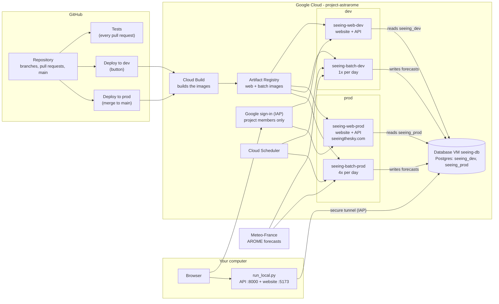

# Seeing Project

Forecasts of astronomical **seeing** (optical turbulence, in arcseconds) for observing sites in
France, computed from Météo-France's AROME weather model and published on
**https://seeingthesky.com** (for now private: Google sign-in, project members only).

| Path | What |
|---|---|
| [`research/`](research/README.md) | The original research scripts and papers. Experiment here. |
| `packages/seeing_core/` | The seeing computation, packaged for the batch job. |
| `packages/seeing_db/` | Database models and migrations. |
| `apps/batch/` | Scheduled job: downloads each AROME run and computes forecasts for every site. |
| `apps/api/` | FastAPI backend that also serves the website. |
| `apps/web/` | React frontend (the pages you see). |
| `infra/` | Google Cloud infrastructure (project `project-astrarome`) and deploy scripts. |
| `.github/workflows/` | Automatic tests and deployments (GitHub Actions). |

How the pieces fit together, and the contracts between them: [docs/architecture.md](docs/architecture.md).

## Where the website runs

| Where | Address | Data | Updated |
|---|---|---|---|
| **Your computer** | http://localhost:5173 | the **dev** database (real forecasts) | instantly, every time you save a file |
| **Dev website** (private) | https://seeing-web-dev-62naw3atjq-uc.a.run.app | the dev database | when you click **Deploy to dev** in GitHub |
| **Production** (private for now) | https://seeingthesky.com | the prod database | automatically, ~15 min after a pull request is merged into `main` |

Both websites ask you to sign in with Google: only the project members' accounts get in, for now.

## How the pieces fit together



- **Batch jobs** download each AROME run from Météo-France, compute the seeing for every site and
  store it in the database. Cloud Scheduler starts them (prod 4 times a day, dev once a day).
- **Web services** show the website and answer its API calls from the database.
- **dev** and **prod** share the same database machine but have separate databases: what you do on
  dev (or on your computer) never touches prod data.
- **GitHub Actions** builds and deploys the code: no one needs Google Cloud passwords or keys for
  that.

## 1. One-time setup

You need: **Git**, **Python 3.12**, **Poetry**, **Node.js 20 or newer** and the **Google Cloud CLI**
(`gcloud`). Docker is optional (only for running the tests or a local database).

**Windows**: open *PowerShell* and run:

```powershell
winget install --id Git.Git -e
winget install --id Python.Python.3.12 -e
winget install --id OpenJS.NodeJS.LTS -e
winget install --id Google.CloudSDK -e
```

Close PowerShell, open a new one, then install Poetry:

```powershell
(Invoke-WebRequest -Uri https://install.python-poetry.org -UseBasicParsing).Content | py -3.12 -
```

**macOS**: install [Homebrew](https://brew.sh) if you don't have it, then in *Terminal*:

```bash
brew install git python@3.12 node
brew install --cask google-cloud-sdk
curl -sSL https://install.python-poetry.org | python3.12 -
```

**Linux**: install git, Python 3.12 and Node 20+ with your package manager, the Google Cloud CLI
from https://cloud.google.com/sdk/docs/install, then
`curl -sSL https://install.python-poetry.org | python3.12 -`.

Close the terminal and open a new one, then check that everything answers with a version number:

```bash
git --version
python --version      # Windows; on macOS/Linux: python3 --version
poetry --version
node --version
gcloud --version
```

If `poetry` is "not found", add the folder the installer printed (`%APPDATA%\Python\Scripts` on
Windows, `~/.local/bin` on macOS/Linux) to your PATH, or restart the computer.

Log in to Google Cloud with the Google account that is a member of the project (a browser window
opens), and choose the project:

```bash
gcloud auth login
gcloud config set project project-astrarome
```

Get the code (only once; afterwards you work in this folder):

```bash
git clone https://github.com/LeonClemClem/Seeing_Project.git
cd Seeing_Project
```

## 2. Run the website on your computer

From the `Seeing_Project` folder. The **first time**, add `--install` (it downloads the libraries,
a few minutes):

```bash
python infra/scripts/run_local.py --install     # Windows
python3 infra/scripts/run_local.py --install    # macOS / Linux
```

The next times, the same command without `--install`. When you see
`Open http://localhost:5173 in your browser`, open that address.

- Change a file under `apps/web/src/` (pages, texts, colours) and save: the page in the browser
  updates by itself.
- Changes to the API (`apps/api/`) restart the API automatically too.
- Press **Ctrl+C** in the terminal to stop everything.

What happens behind the scenes: the script opens a secure tunnel to the **dev database** on Google
Cloud (so you see real forecasts), then starts the API (http://localhost:8000/api/docs) and the
website. It never changes the structure of the database. Accounts you create on the *Compte* page
are real accounts of the dev database.

After pulling changes from GitHub (`git pull`), run once with `--install` again in case the
libraries changed.

## 3. Make a change and publish it

`main` is the published version: nobody changes it directly. Each change goes through a
**branch** and a **pull request** (PR). The full workflow, with good commit messages, is in
[.claude/skills/github/SKILL.md](.claude/skills/github/SKILL.md).

1. Start from an up-to-date `main` on a new branch:
   ```bash
   git switch main
   git pull
   git switch -c feat/my-change
   ```
2. Make your change, check it on http://localhost:5173 (section 2).
3. Save it in git and send it to GitHub:
   ```bash
   git add <the files you changed>
   git commit -m "web: what you changed"
   git push -u origin feat/my-change
   ```
4. Open the pull request: go to https://github.com/LeonClemClem/Seeing_Project, click
   **Compare & pull request**, describe the change, **Create pull request**.
5. GitHub runs the tests on it (the **Tests** checks at the bottom of the PR). Wait for them to
   turn green. If one is red, click **Details** to see what failed, fix it, commit and push again.
6. *Optional*: try it on the dev website (section 4).
7. **Merge** the pull request: prod updates itself (section 5).

## 4. Deploy to dev (try a branch online)

The dev website is a private copy of the site where you can try a branch before it goes to
production, with the dev data.

1. Push your branch to GitHub (section 3, step 3).
2. Open this page (bookmark it):
   **https://github.com/LeonClemClem/Seeing_Project/actions/workflows/deploy-dev.yml**

   To get there by clicking instead: on the repository page, click **Actions** in the top bar
   (between *Pull requests* and *Projects*), then **Deploy to dev** in the left-hand list
   *All workflows*.
3. Above the list of past runs there is a grey box saying *"This workflow has a
   workflow_dispatch event trigger."* On its right is a **Run workflow ▾** button: click it.
4. A small window opens with **Use workflow from: Branch: main ▾**. Click `main` and choose
   **your branch** in the list (type its name to find it).
5. Click the green **Run workflow** button in that window. After a few seconds a new line
   appears in the list with a yellow dot (running); click it to follow each step.
6. Wait for the green tick: 10–15 minutes the first time for a branch, a few minutes if that
   exact version was already built.
7. Open https://seeing-web-dev-62naw3atjq-uc.a.run.app (sign in with Google).

If there is no **Deploy to dev** in the list or no **Run workflow** button: GitHub only shows
this button once the file `.github/workflows/deploy-dev.yml` is on `main`, and only to people
who can push to the repository. Check that you are signed in to GitHub with your account.

Only one branch is on dev at a time: the last one deployed. If your branch changes the structure
of the database, deploying it to dev applies that change to the dev database.

## 5. Deploy to prod (publish on seeingthesky.com)

Production is updated **only** by merging a pull request into `main`:

1. Open your pull request and check the **Tests** are green.
2. Click **Squash and merge**, then **Confirm**.
3. GitHub runs **Deploy to prod** by itself (see the **Actions** tab): the tests again, then the
   build, the database update and the new version of the website and batch job. About 10–15
   minutes.
4. Green tick: https://seeingthesky.com shows the new version.

If a deployment is red, the previous version stays online: nothing breaks for visitors. Click
the failed run, then the red step, to read the error. Fix it in a new pull request, or ask for
help. To re-run a deployment that failed for a temporary reason, open the run and click
**Re-run jobs**.

New forecasts appear on their own (the batch job runs 4 times a day). To compute one right away
after a change to the calculation:

```bash
gcloud run jobs execute seeing-batch-prod --region us-central1 --project project-astrarome
```

Deploying by hand (without GitHub), going back to an older version, and the infrastructure
itself are explained in [infra/terraform/README.md](infra/terraform/README.md) (*Day to day*,
*Roll back*).

## 6. Troubleshooting

| Message | What to do |
|---|---|
| `could not read the database password` | Run `gcloud auth login` again (logins expire), with the project member's account. |
| `port(s) [...] already in use` | The site is already running in another terminal: stop it with Ctrl+C there. Always stop with Ctrl+C rather than closing the window (on Windows, closing it can leave the site running in the background); if that happened, restart the computer. |
| `'poetry' was not found` (or `npm`, `gcloud`) | Install it (section 1), then open a **new** terminal. |
| `dependencies are not installed yet` | Run the command once with `--install`. |
| The page loads but shows no forecast | Check the terminal for an error from the API; run with `--install` after a `git pull`. |
| The database tunnel does not open | Check your internet connection and `gcloud config get project` (must be `project-astrarome`). |

Changing the **structure** of the database (a new table or column) needs a migration: see
[database/README.md](database/README.md). Your computer uses the dev database as it is; the
migration reaches it when the branch is deployed with **Deploy to dev**.

## 7. For developers

Also needs Docker and make. Local database instead of the dev one:

```bash
make db-up migrate dev-seed   # local Postgres on :5432, tables, a fake forecast run
make run-local ARGS="--db local"
```

```bash
make api-install web-install
make api-dev        # FastAPI on http://localhost:8000 (API docs at /api/docs)
make web-dev        # Vite on http://localhost:5173, proxies /api to :8000
make test-api       # pytest against a throwaway Postgres on :55434
make test-web       # typecheck + eslint + vitest
make test-core test-batch
make web-image      # production image (apps/api/Dockerfile, repo root as context)
```

Infrastructure, deployments by hand (`infra/scripts/deploy.sh`), CI/CD and the domain:
[infra/terraform/README.md](infra/terraform/README.md).
