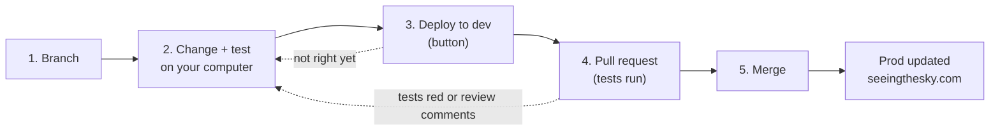

# The development cycle, step by step

How a change goes from your computer to https://seeingthesky.com. Do these steps in order for
**every** change: a new text, a fix, a new page. Commands are typed in a terminal (*PowerShell* on
Windows, *Terminal* on macOS), inside the `Seeing_Project` folder. The one-time setup (installing
the tools, `gcloud auth login`) is in the [README](../README.md#1-one-time-setup).

## The two environments

| | **dev** | **prod** |
|---|---|---|
| Address | https://seeing-web-dev-62naw3atjq-uc.a.run.app | https://seeingthesky.com |
| Purpose | try a change online before publishing it | the real site |
| Database | `seeing_dev` (also the one your computer uses) | `seeing_prod` |
| Which code | the branch you choose with **Deploy to dev** (any branch) | always `main` |
| Updated by | you, with the **Deploy to dev** button | GitHub, automatically after a merge |
| Who can open it | project members (Google sign-in) | project members, for now |

The two databases are separate: whatever you do on your computer or on dev never changes the
real site's data.



## 1. Create a branch

A branch is your own copy of the code where you can work without touching `main` (the published
version). Always start from the latest `main`:

```bash
git switch main
git pull
git switch -c feat/short-description
```

- Pick a name that says what you are doing: `feat/fisheye-legend`, `fix/typo-tutorial`,
  `docs/about-page`. Start with `feat/` (new thing), `fix/` (correction) or `docs/` (texts).
- One branch per change. For a second, unrelated change, finish this cycle first, or start again
  at step 1 from `main`.
- `git status` tells you which branch you are on (`On branch feat/...`).

## 2. Make your changes and test them on your computer

Start the site on your computer (the first time after `git pull`, add `--install`):

```bash
python infra/scripts/run_local.py      # Windows
python3 infra/scripts/run_local.py     # macOS / Linux
```

Open http://localhost:5173. Edit the files (pages are in `apps/web/src/pages/`, texts and
translations in `apps/web/src/i18n/`), save, and the page updates by itself. The data is the
real dev data. Press **Ctrl+C** in the terminal to stop.

When it looks right, save your work in git (a *commit*) and send it to GitHub (*push*):

```bash
git status                          # lists the files you changed
git add apps/web/src/pages/Static.tsx   # the files you changed (several names are fine)
git commit -m "web: add the team photo to the À propos page"
git push -u origin feat/short-description
```

- The message says what changed, starting with the part of the project (`web:`, `api:`,
  `research:`, `docs:`).
- You can commit and push as many times as you want; each push updates your branch on GitHub.
  The `-u origin <branch>` part is only needed the first time; afterwards `git push` is enough.
- Never add data files, passwords or personal files. `git status` before `git add` shows what
  would go in.

## 3. Try it online with "Deploy to dev"

Optional but recommended, especially when you want someone else to see the change. **Any branch
can be deployed to dev**, as long as it has been pushed (step 2).

1. Open https://github.com/LeonClemClem/Seeing_Project/actions/workflows/deploy-dev.yml
   (or: repository page → **Actions** at the top → **Deploy to dev** in the left list).
2. Click **Run workflow ▾** (right side, in the grey box above the list of runs).
3. In **Use workflow from: Branch: main ▾**, choose **your branch**.
4. Click the green **Run workflow**. A new line appears with a yellow dot: it is running.
5. Wait for the green tick (about 10–15 minutes; red cross: see [When something goes
   wrong](#when-something-goes-wrong)).
6. Open https://seeing-web-dev-62naw3atjq-uc.a.run.app and check your change.

Dev shows only **one branch at a time**: the last one deployed. If you change something again,
commit, push and run **Deploy to dev** again.

## 4. Open a pull request

A pull request (PR) asks to put your branch into `main`. It is where the tests run and where the
change is reviewed.

1. Open https://github.com/LeonClemClem/Seeing_Project. A yellow banner shows your recently
   pushed branch: click **Compare & pull request**. (No banner: **Pull requests** → **New pull
   request** → *compare:* your branch.)
2. Check that it says **base: main ← compare: your branch**.
3. Give it a clear title and describe what you changed and why (screenshots welcome).
4. Click **Create pull request**.
5. At the bottom of the PR, the **Tests** checks start (yellow dots). Wait until they are all
   green ✓ (a few minutes).
   - A red ✗: click **Details** next to it to see the error. Fix it on your computer (step 2),
     commit and push: the PR updates and the tests run again.
   - Comments from a reviewer: same thing, fix, commit, push.

## 5. Merge the pull request

When the tests are green (and the change was reviewed if needed):

1. On the PR, click **Squash and merge**, then **Confirm squash and merge**.
2. GitHub starts **Deploy to prod** by itself: follow it in **Actions** → **Deploy to prod**. It
   runs the tests again, then publishes (about 10–15 minutes).
3. Green tick: https://seeingthesky.com shows your change.
4. Clean up on your computer and get ready for the next change:
   ```bash
   git switch main
   git pull
   git branch -D feat/short-description
   ```
   GitHub offers a **Delete branch** button on the merged PR: click it too.

Then start again at step 1 for the next change.

## When something goes wrong

- **A deployment (dev or prod) is red:** the previous version stays online, nothing is broken
  for visitors. Click the red run, then the red step, to read the error. If it looks temporary
  (a timeout, a Google error), click **Re-run jobs**. Otherwise fix it in a branch and open a new
  pull request, or ask for help with a link to the run.
- **`git push` is refused** (`rejected` / `non-fast-forward`): someone else pushed to your branch.
  Run `git pull`, then `git push` again.
- **`git pull` talks about a *conflict*:** stop and ask for help; don't delete anything.
- **You committed on `main` by mistake** (before pushing): run `git switch -c feat/my-change`.
  Your commits move with you to the new branch. Then reset `main` with `git switch main` and
  `git reset --hard origin/main` (this only throws away commits that are now safely on the new
  branch).
- **The site on your computer does not start:** see the [README troubleshooting
  table](../README.md#6-troubleshooting).

## Good to know

- `main` only changes through merged pull requests: never push to it directly.
- **Database changes** (a new table or column) need a migration ([database/README.md](../database/README.md)).
  Deploying the branch to dev applies it to the dev database; merging applies it to prod. Ask for
  a review before merging one.
- New forecasts arrive by themselves (prod 4 times a day, dev once a day). To compute one now:
  `gcloud run jobs execute seeing-batch-prod --region us-central1 --project project-astrarome`
  (or `seeing-batch-dev` for dev).
- More detail on the git workflow and commit messages: [.claude/skills/github/SKILL.md](../.claude/skills/github/SKILL.md).
